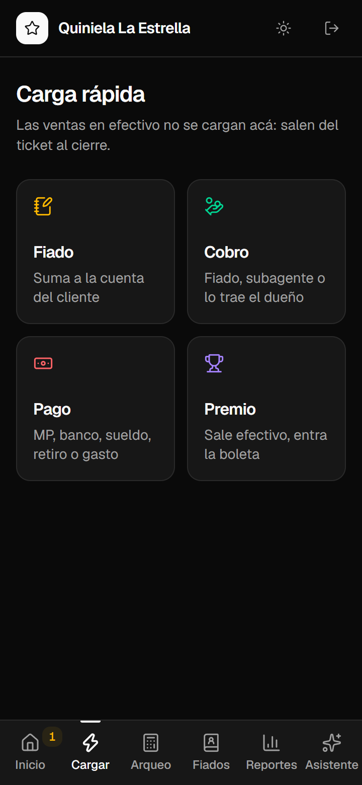
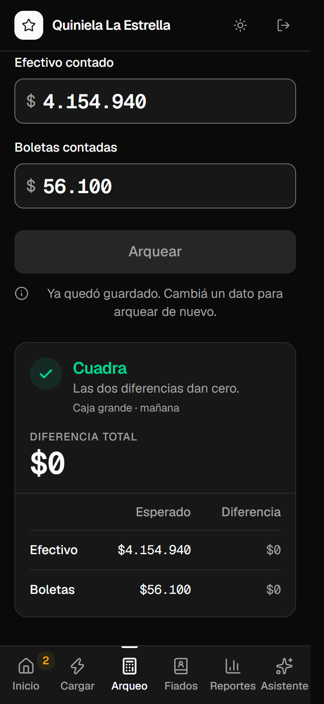
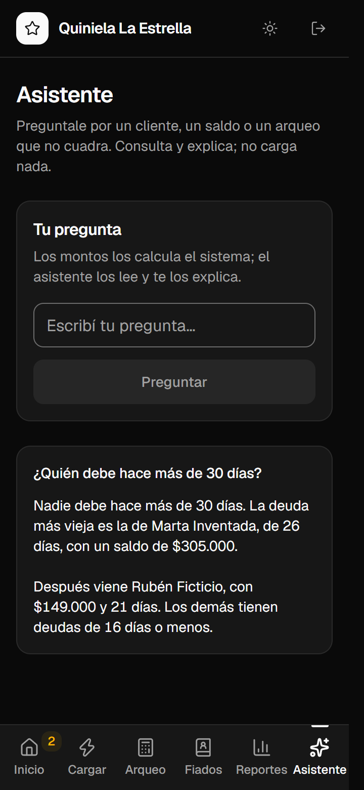
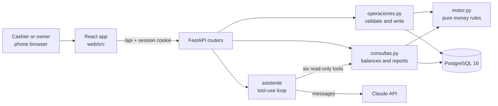

# quiniela-system

Cash ledger and cash counts for a lottery agency, replacing seven paper notebooks. A simulated case study.

[](https://github.com/nachixxs/quiniela-system/actions/workflows/ci.yml) [](LICENSE) [](Dockerfile)

Status: simulated case study. No real agency uses it, and every name, user and amount in the repo is fictional. It runs locally without external accounts; only the AI assistant needs an Anthropic API key.

<p align="center">
  
  
  
</p>

## The problem

A *quiniela* is Argentina's state-run numbers lottery. An agency keeps a counter box (*caja chica*) and a main box (*caja grande*) and writes every movement by hand in seven notebooks. Closing a box means copying the same figures from one notebook to the next and adding them on a calculator, estimated at about two hours a day (not yet timed, see [Closing time](#closing-time-before-and-after)). Without hand sums, nothing answers how much a regular customer owes, how much Mercado Pago money has piled up, or whether count differences follow a pattern: they die on the day's sheet.

## Field survey

The survey covered photos of six notebook folders (12 photos, 5 to 25 September 2026) and answers from the agency's owner. Only patterns and orders of magnitude left it; no real name or amount is in the repo.

- Three of the seven notebooks are derived data (a running total, the day's book, the day's summary). They became reports, not screens.
- The counter box balances almost always (a small surplus in 1 of 4 photographed shifts). The main box's morning count is off by tens to a few hundred pesos on 5 of 6 photographed days. Differences are written down and never corrected.
- When a customer buys on credit (*fiado*) and pays an old debt in the same shift, the credit sale is crossed out by hand so it is not copied forward as unpaid. Red crosses help add up a customer's debt later. Both steps disappear once nothing is copied.
- One "Paid" line holds bank deposits, owner withdrawals, Mercado Pago transfers, a courier fee and wage advances. In the system each is its own movement type.

## What it does

The interface is in Spanish; terms are translated on first use.

- **Credit sale in two taps.** The cashier taps *Fiado* (credit), enters 4,000 and picks "Rubén Ficticio". The customer's debt is computed from the ledger, never stored. Debtors can be listed by amount or by age, and searched by name or alias with a trigram index.
- **Prize payout without unbalancing the box.** Paying a prize takes cash out and puts a prize ticket (*boleta*) in, which counts as money inside the box. The expected total does not change.
- **Shift close.** The cashier types the terminal's closing ticket, sees the expected cash and tickets of the counter box, counts the drawer and enters both figures. The count is saved whether or not it matches, with its differences, and closes the shift.
- **A count that does not match.** The screen offers "Preguntarle al asistente" (ask the assistant), which explains the difference from movements the code selects.
- **A late entry.** A prize payout forgotten the night before is entered as an adjustment dated to that night. It does not change today's expected value. If it matches the old difference exactly, that count becomes *explicada* (explained).
- **Mistakes.** A movement is never edited or deleted. It is voided from the home screen with a reason and a reversing entry.
- **Reports.** Day close, count differences, Mercado Pago accumulated since the owner last brought that cash from the bank, sales per game, prize-ticket batches (*rendiciones*) and a month close with a bar chart.

## How it works



One credit sale and the close of a shift:

1. The web app sends `POST /api/movimientos` with a fresh UUID in `ref_cliente`. A middleware rejects any request that carries `negocio_id` (the business). The business comes from the session.
2. `crear_movimiento` returns the existing row if it has seen that UUID. Otherwise it locks the open shift and inserts a `fiado` movement: cash down, customer debt up.
3. At close, `cargar_ticket` turns the terminal ticket into sales movements and returns the expected cash and tickets, computed by `motor.esperado`.
4. `guardar_arqueo` (*arqueo* = cash count) stores the count with both differences, sets the next starting point to what was counted and closes the shift.

Four counts a day (the main box in the morning and evening, the counter box at the close of each shift) use one equation for every box:

```text
(cash + tickets) now = (cash + tickets) at the previous count + inflows - outflows
```

A shift does not close without its count, a day does not close with an open shift, and a closed day never reopens.

## Gaps found, and how they were closed

| # | What happens at the counter | Resolution |
|---|---|---|
| B1 | The night count was taken at 20:20 but betting runs until 20:40. The last 20 minutes landed in the next morning as a false surplus. | No code. The owner's decision: with the system, the night count moves to 20:40, after betting closes. The simulator schedules it there (`app/simulacion.py:140`). |
| B2 | Telekino is sold as physical cards outside the terminal and counted per shift, but the ticket form took a daily cumulative total. | `cargar_ticket` takes Telekino per shift and subtracts only the other games (`app/operaciones.py:234`). Test: `test_telekino_va_por_turno_y_el_resto_acumulado`. |
| B3 | The terminal also sells Quiniela Instantánea, which was missing from the game list. | Added to the seed (`app/seed.py:9`). |
| B4 | When the main box runs short mid-shift, cash is taken from the counter box. | `traspasar` accepts an optional `monto` (a partial transfer) with no prior count. Test: `test_traspaso_parcial_no_es_el_del_arqueo`. |

## The simulated month

`python -m app.simulacion` loads Monday-to-Saturday days through the same functions the API calls, so every rule above applies. Volumes, error sizes and patterns come from the survey: recurring credit customers, credit sales crossed out in pairs, sub-agents settling with prize tickets, bank deposits, owner withdrawals, a weekly partial transfer, small morning differences in the main box and a rare surplus at the counter. The seed is fixed, but the window is the 30 days before the run, so the month shifts with the date. Run of 1 October 2026, recorded in the project notes:

| Measure | Value |
|---|---|
| Operating days | 26 |
| Movements | 1,703 (65.5 per day, 86 at most) |
| Cash counts | 104: 72 balanced, 32 with a difference |
| Outstanding customer credit at month end | $545,500 ARS |
| Month report vs direct sums of what was loaded | Equal, zero adjustments |

## Closing time: before and after

> [!NOTE]
> Not measured yet. The cells below hold `TODO(7.5)` until the timings exist.

<!-- TODO(7.5): fill the three rows with numbers timed with a clock, then delete this comment and the note above.
  Row 1, "Notebooks": minutes to close one full day by hand, timed at the agency (all four counts and the day close).
  Row 1, "System": minutes to enter one simulated day (movements, tickets, counts, day close) and close it, timed the same way.
  Row 2: number of movements in the day timed, one number per column (the same simulated day for "System").
  Row 3: date of each timing. -->

| | Notebooks | System |
|---|---|---|
| Minutes to close one day | TODO(7.5) | TODO(7.5) |
| Movements in that day | TODO(7.5) | TODO(7.5) |
| Date measured | TODO(7.5) | TODO(7.5) |

## Engineering decisions

1. **One ledger, void by reversing entry.** Rows are never edited or deleted; a void is a copy with `anula_id` and a reason. Discarded: stored balances with editable rows, which erase the trail that explains a difference. Cost: every expected value is a query over the movements since the last count, and voiding a movement from before a count must be flagged as an adjustment. See [ADR 0001](docs/adr/0001-ledger-and-count-reanchoring.md).
2. **A count is saved even when it does not match, and re-anchors the box.** Discarded: carrying the difference forward (one shortfall would taint every later count) and blocking the save (staff would invent a number). Cost: a count with a difference needs the *explicada* state and late adjustments to be closed out later. Same ADR.
3. **Money rules as pure functions.** `app/motor.py` (95 lines) has no database or SQLAlchemy import. Discarded: SQL aggregates scattered in queries. Cost: `operaciones.py` and `consultas.py` load the movements since the last count into Python, and the effect table must match the movement types the models accept (`test_todo_tipo_que_acepta_la_base_tiene_efecto`).
4. **Idempotent writes with a client UUID, serialized per business.** `ref_cliente` is unique per business (`app/modelos.py:117`), so a retry on a flaky connection returns the original movement. `_turno` locks the open shift and day with `FOR UPDATE`, so two writes of one business run one after the other (`test_dos_escrituras_del_mismo_negocio_van_en_fila`). Discarded: de-duplicating by time window, and no locking. Cost: throughput is one writer per business, which fits one counter. The web app generates one UUID per payload with `useMemo`, which React does not guarantee to keep across a retry (open item, see Limitations).
5. **The shortest code that works.** A line budget per component and tests only where money is at stake. Discarded: the approach of an earlier agency project (about 57,000 lines, tests at 3.6 times the code, almost half of them covering scaffolding). Cost: no tests for config, scripts or Docker, no unit tests in `web/`, and ruff and the E2E suite stay out of CI.

## LLM

The assistant answers questions in Spanish over the business data and diagnoses counts that do not match.

- **Model:** `claude-sonnet-5-5`, set in the `MODELO` constant (`app/asistente/__init__.py:13`). Effort is `low`, or `medium` when the request carries a count to diagnose. The API call has a 30 s timeout and one retry.
- **Model decides:** which tools to call and with which filters (date, customer name, box), and the wording of the answer. The answer is model-written prose, and it is the text the user sees.
- **Code decides:** the business (from the session), every figure (balances, differences, the diagnosis checklist), the turn and cost caps, and the text of every error the API returns. The system prompt tells the model not to add up amounts; nothing verifies the figures in an answer.
- **Where the prompt lives:** `SYSTEM` (`app/asistente/__init__.py:24`) and the tool descriptions in `TOOLS` (`app/asistente/tools.py:25`). Both form the cached prefix of every call, so they stay byte-identical; the date goes in the user message. Both are edited in code and deployed with the app (no admin screen).

| Tool | What it does | Access |
|---|---|---|
| `clientes` | Debtors, or customers matching a name or alias with their balance and last movements | read |
| `movimientos` | Movements of a day, filtered by shift, box or type | read |
| `reporte` | Day close (`YYYY-MM-DD`) or month close (`YYYY-MM`) | read |
| `mercado_pago` | Mercado Pago accumulated since the owner last brought that cash | read |
| `diferencias` | Counts with a difference, with the late entries that explained them | read |
| `diagnosticar_arqueo` | Checklist for one count; the code also runs it before the first call when the request has a count id | read |

**Evals:** none yet (not measured). What would be measured: a fixed list of questions over the simulated month, each with the expected figure taken from the reports, scored on whether the figure in the answer equals the tool output. Checked by hand so far: 3 of 3 questions correct on the local database during CP6, and the diagnosis found a seeded credit sale of $12,000. `tests/test_asistente.py` (4 tests) uses a fake client and never calls the API.

**Cost and latency:** about USD 0.005 per question with prompt caching, from one run against the real API on the local database (1,939 tokens written to the cache once, read on the next 4 calls). Latency: not measured.

**If the API is down or slow:** `POST /api/asistente` returns 503 with a message and the screen shows "El asistente no está disponible ahora. El resto del sistema funciona igual." Nothing is lost: the assistant only reads and keeps no history. With no key configured the router answers 503 without calling the API (`test_sin_api_key_503_sin_llamar_a_nada`).

**Personal data:** the question (up to 500 characters) and, through the tools, customer names and aliases, movement notes, counterparties, amounts and times reach the Anthropic API. Phone numbers are not sent and each text field is cut at 200 characters. The server stores nothing from the assistant; the browser keeps the conversation in memory. The log carries token counts and, on a failure, the exception class, never a question or an answer.

**Prompt injection:**

| Defense in the code | OWASP LLM category |
|---|---|
| Six read-only tools. No tool writes, voids or corrects, so a hijacked model can only read. | LLM06 Excessive Agency |
| `negocio_id` is absent from every tool schema and is filled in from the session. A test calls the tools as another business and gets nothing. | LLM06, LLM02 Sensitive Information Disclosure |
| Customer names, notes and reasons reach the model inside `tool_result` blocks or `<diagnostico>`, which the system prompt calls data. `<` is escaped in the question and the diagnosis so a pasted closing tag cannot end the block. | LLM01 Prompt Injection |
| The answer renders as plain text in React (`Asistente.tsx:70`), and no code acts on it. | LLM05 Improper Output Handling |
| Question 500 characters, 5 turns, 10 tool calls, 60,000 input tokens, `max_tokens` 2,000. | LLM10 Unbounded Consumption |

These limit what an injected instruction can do; they do not stop a note from reaching the model. Design record: [ADR 0002](docs/adr/0002-assistant-reads-code-computes.md).

## Getting started

Requirements: Docker with Docker Compose. For tests, Python 3.14. For the frontend dev server, Node 24.

```bash
cp .env.example .env                        # then set POSTGRES_PASSWORD and SEED_PASSWORD
docker compose up -d --build                # PostgreSQL on 127.0.0.1:5433, app on 127.0.0.1:8000
docker compose exec api python -m app.seed  # business "Quiniela La Estrella", user "demo", two boxes, eight games
docker compose exec api python -m app.simulacion  # the simulated month, about a minute
```

Open `http://localhost:8000` and log in as `demo` with your `SEED_PASSWORD`. You will see the login screen and then the home screen with both boxes. The *Reportes* screen holds the simulated month: month close, a sales-per-day chart, count differences and Mercado Pago. The API docs are at `http://localhost:8000/api/docs`. The container applies the Alembic migrations on start.

For frontend work with hot reload, keep the API running and run `cd web && npm ci && npm run dev`. Vite serves `http://localhost:5173` and proxies `/api` to port 8000.

| Variable | Used for | Required | Where it comes from |
|---|---|---|---|
| `POSTGRES_USER`, `POSTGRES_PASSWORD`, `POSTGRES_DB` | The Compose database | Yes | Invented locally (`.env.example` suggests `quiniela` for user and database) |
| `SEED_PASSWORD` | Password of the seeded user `demo` | Yes, for the seed | Invented locally |
| `ANTHROPIC_API_KEY` | The assistant | No: blank means the assistant answers 503 | Anthropic Console (paid API) |
| `DATABASE_URL` | Connection string. Compose sets it; the tests read it | Tests | Your test database |
| `PRODUCCION=1`, `DATABASE_URL`, `ANTHROPIC_API_KEY` | Render service (`render.yaml`); `PRODUCCION=1` hides `/api/docs` | Production only | Render dashboard |
| `NEON_DATABASE_URL`, `BACKUP_PASSPHRASE`, `B2_KEY_ID`, `B2_APPLICATION_KEY`, `B2_BUCKET`, `B2_ENDPOINT` | Daily backup job | Production only | GitHub Actions secrets |

The seed also reads `SEED_NEGOCIO` and `SEED_USUARIO` (defaults: the business and user above). The tests need `DATABASE_URL` and nothing else.

Troubleshooting:

- Ports 5433 and 8000 are fixed in `compose.yaml`: a second checkout with Docker up collides with the first.
- Changing `POSTGRES_PASSWORD` after the first start does not change the existing `db_data` volume. `docker compose down -v` recreates it and deletes its data.
- `app.simulacion` refuses to run on a business that already has days loaded.

## Tests

| Suite | Command | Needs |
|---|---|---|
| pytest | `.venv/bin/python -m pytest` | PostgreSQL 16 and `DATABASE_URL` pointing at an empty database |
| Playwright E2E | `cd e2e && npx playwright test` | A built `web/dist`, Windows (paths and snapshots are `win32`), and role `quiniela_test` with database `quiniela_e2e` on port 5433 (`e2e/global-setup.ts`) |

```bash
python -m venv .venv                        # Windows: .venv\Scripts\python
.venv/bin/pip install -r requirements.txt
docker compose exec db sh -c 'createdb -U "$POSTGRES_USER" quiniela_test'
export DATABASE_URL="postgresql+psycopg://<POSTGRES_USER>:<POSTGRES_PASSWORD>@127.0.0.1:5433/quiniela_test"
.venv/bin/python -m pytest
```

The pytest suite applies the migrations and rolls back each test's transaction. It covers what can cost money: the effect of each of the 15 movement types, reversing entries, expected values and counts, customer balances, late adjustments, idempotency, tenant isolation, concurrent writes, the login throttle and a full simulated day through the database and through HTTP. The assistant tests use a fake client. The E2E suite walks one day in a browser (login, shifts, counts, reports, a customer balance, a void, day close), runs axe on nine screens in both themes at 360, 768 and 1280 px, and compares 54 screenshots.

Numbers at the current commit: 76 pytest tests (40 test functions, parametrized cases included) in 4 files, 593 non-blank lines against 1,610 in `app/`; 8 E2E tests in one file of 364 lines. CI (`.github/workflows/ci.yml`) runs pytest against PostgreSQL 16 and builds `web/`; it does not run the E2E suite or ruff.

## Deployment

The repo ships configuration, not a live instance. `render.yaml` defines a Render web service built from the `Dockerfile` (multi-stage: Node 24 builds `web/`, Python 3.14 serves it with the API from one origin, so there is no CORS) with a health check on `/api/salud`. `.github/workflows/backup.yml` runs `pg_dump` daily at 06:00 UTC on the managed PostgreSQL, encrypts the dump with GPG and uploads it to a Backblaze B2 bucket with Object Lock (30-day retention). A backup was restored locally and matched the source, and the E2E suite passed once against a deployed instance (recorded in the project notes). Render's free plan sleeps after 15 minutes idle and takes about a minute to wake.

## Limitations and next steps

- Next step: evals for the assistant (see LLM) and a latency measurement.
- Next step: renew the session with use. It lasts a fixed 12 hours from login (`app/auth.py:12`), so a counter open longer loses it during the night shift.
- A partial transfer cannot be voided and has no ceiling; a mistyped amount shows up as mirrored differences in both boxes' counts.
- After the counter box's night count the shift is closed, so a late sub-agent payment cannot be entered that day. It goes in the next morning.
- The login throttle lives in process memory (`FALLOS` in `app/routers/auth.py`), so it assumes one instance.
- Telekino card stock stays on paper. Sub-agent commissions, invoicing, user roles and automatic ticket reading are out of scope.
- The 32 differences of the simulated month all stay unexplained; the simulator does not generate late adjustments.
- Next step: the closing-time measurement in the table above.

## License

[MIT](LICENSE)
